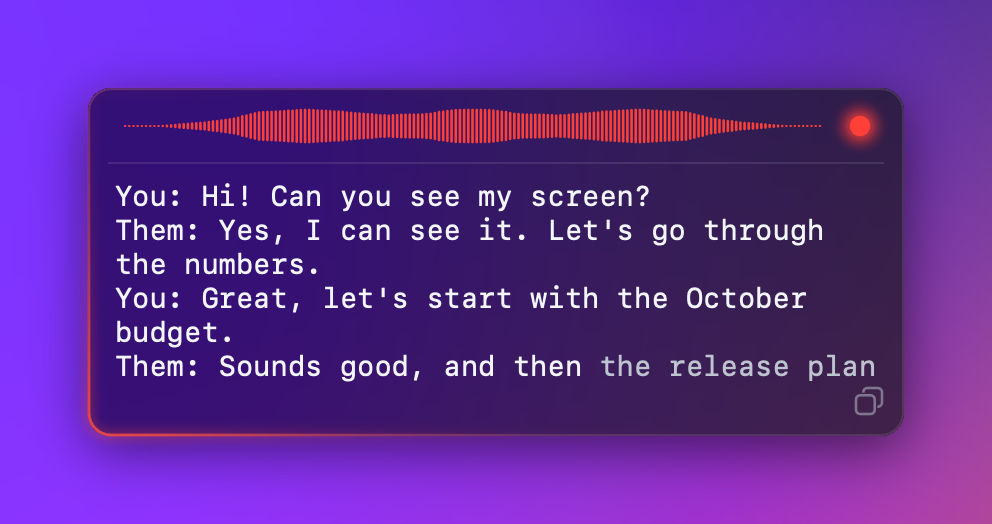
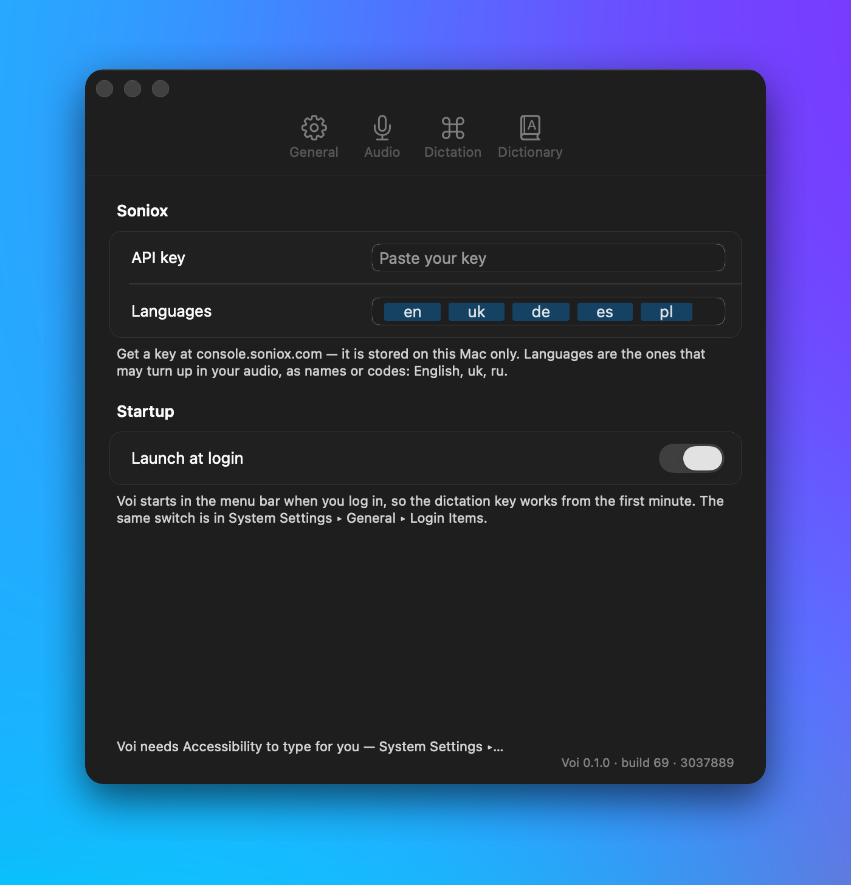
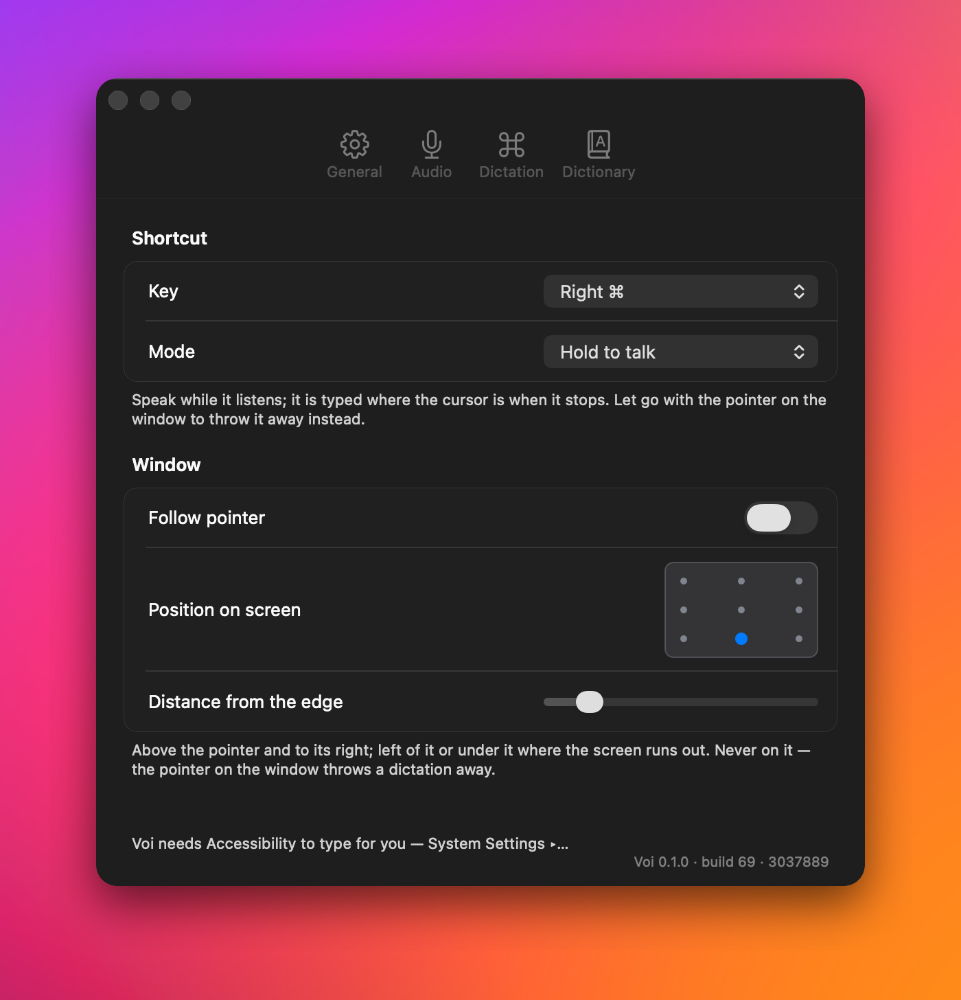

# Voi

Live transcription and dictation for macOS and Windows, in any language —
even switching languages mid-sentence.

**Bring your own key (BYOK).** Voi talks to [Soniox](https://soniox.com), the
speech recognition behind it, directly with your own API key. There is no Voi
account, no subscription and no server in between: your audio goes from your
computer straight to Soniox, and you pay Soniox only for what you use.

## Typing

Hold a key (Right ⌘ on the Mac, Right Ctrl on Windows), speak, and let go: the
text is typed wherever your cursor is. The words appear as you speak, beside
the pointer or wherever you put the window.

## Calls

A small HUD in the corner of the screen records both sides of a call, you and
them, and shows the transcript live. Each session is saved as a Markdown file.

## Settings

  
  

## Download

The latest build is always on the
[Releases](https://github.com/ontionos/get-voi/releases/latest) page:
`Voi-<version>.dmg` for the Mac, `Voi-<version>.exe` for Windows.

## Install

**macOS** (14.4 or later). Open the DMG and drag Voi into Applications. Voi is
not notarized by Apple, so the first time macOS may say it cannot verify it:
open System Settings → Privacy & Security and click **Open Anyway**. Allow the
microphone and, for calls, system audio when Voi asks.

**Windows** (10 or 11, x64). Run the `.exe`. It installs Voi for you alone,
with no administrator rights, and adds it to the Start menu. The installer is
not signed, so Windows may show "Windows protected your PC": click
**More info**, then **Run anyway**. Running a newer `.exe` updates Voi in
place; your settings, key and transcripts are kept.

## Your Soniox key

Sign up at [console.soniox.com/signup](https://console.soniox.com/signup/),
create an API key, and paste it into Voi's Settings → General. It is kept on
your computer only. Apart from Soniox, the one place Voi connects to is this
page on GitHub, to check for updates.

## Updates

Voi checks this page now and then. When a newer build is out, **Update
Available** appears in its menu, just above Quit; choosing it downloads the
new file.
